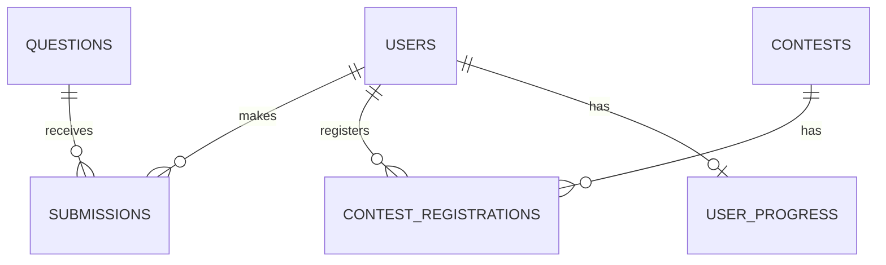

# SkillForge ER Diagram

The ER diagram shows how the six tables in SkillForge are connected to each other. It helps us understand how data is stored and how different tables work together.

In this diagram:

- **PK (Primary Key):** Uniquely identifies each record.
- **FK (Foreign Key):** Connects one table to another.
- **UK (Unique Key):** Prevents duplicate values.

## 1. Relationships Between Tables

1. **Users and Submissions:** One user can submit answers many times, but each submission belongs to one user.

2. **Questions and Submissions:** One question can have many submissions, but each submission is linked to one question.

3. **Users and Contests:** A user can register for many contests, and a contest can have many users. The `contest_registrations` table manages this relationship.

4. **Users and User Progress:** Each user can have zero or one progress record. The `user_id` column in `user_progress` is unique, so duplicate progress records are not allowed for the same user.

## 2. ER Diagram

The following Mermaid code shows all six tables and their relationships.

## 3. Diagram Files

The Mermaid source code is saved in `er_diagram.mmd`. It can be used to view or generate the ER diagram.

**Note:** The PNG image has not been generated because Mermaid CLI (`mmdc`) is not installed in the current environment. The source file is ready and can be converted into a PNG when Mermaid CLI is available.

## Conclusion

The ER diagram gives a clear view of the SkillForge database. It shows how users, questions, submissions, contests, registrations, and progress are connected. These relationships help keep the database organized and avoid unnecessary duplicate data.